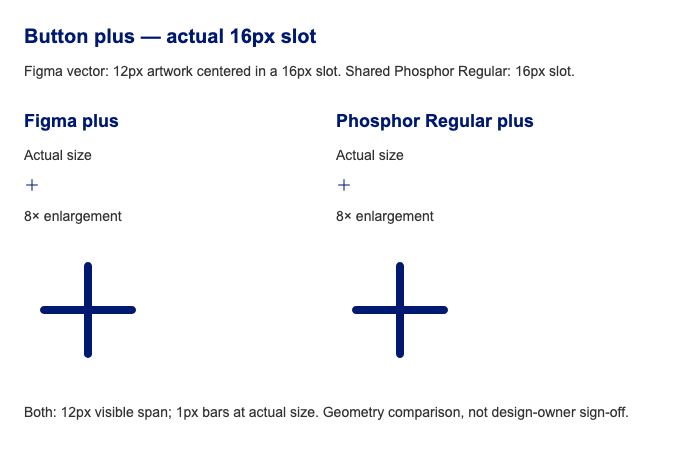

# Button icon adoption — 2026-10-21

Button now uses the approved `plus` from Phosphor Regular 2.1.1 through the shared
sprite. The canonical fixture references `/icons/sprite.svg#plus`; the docs and
Storybook bind that reference to the bundled asset URL, and the static example
binds it to its deployed `assets/icons/` directory.

The comparison is rendered from the Figma plus vector layer and the shared
Phosphor SVG, normalized to the same visible width. The full-frame screenshot
below is supporting context.

## Comparison and decision

The original inline plus was handwritten, not a recorded Figma export. At its
24px rendered size it had square ends, 2px bars, and a 16px visible span.
Phosphor Regular has rounded ends, 1.5px bars, and an 18px visible span in the
same centered 24px square. This is an intentional appearance change, not a
pixel-identical substitution.

The live [Button Figma frame, node 808:2014](https://www.figma.com/design/jQ3EiYqe3uEvFbid5ewc41/Colorado-Design-System?node-id=808-2014&m=dev)
was inspected through the Aten Chrome profile on 2026-10-21. Its Icon Only
example uses a thin plus. The page still mentions Font Awesome in legacy icon
instructions; that text does not prove a Phosphor path match. Of the approved
shared artwork, Phosphor Regular `plus` is the closest match to that treatment.
The user explicitly approved replacing the thicker square-ended implementation
with this thinner rounded plus after reviewing the comparison. This records
that implementation decision; it does not assert design-owner or stable sign-off.

The native button retains its accessible name, a decorative and unfocusable SVG,
16px square icon geometry, default 40px target, native disabled behavior,
state colors, and forced-colors system colors. The symmetric plus needs no RTL
mirroring. Source values remain in the pinned package and generated shared
sprite; no component-local path is maintained.

The Figma plus SVG was copied from its vector layer on 2026-10-21:
[Button plus source](https://www.figma.com/design/jQ3EiYqe3uEvFbid5ewc41/Colorado-Design-System?node-id=1377-1611&m=dev).
Its native bounds are 12×12; the SVG path describes 1px bars with rounded ends.
The comparison uses the exported geometry directly, rather than enlarging a raster crop.

## Review at the specified 16px slot — 2026-10-21

The Figma plus vector has a 12px visible span with 1px rounded bars. The shared
Phosphor Regular plus has a 192-unit visible span and 16-unit bars in its 256-unit
viewBox: at a 16px slot these render as 12px and 1px respectively. The previous
24px slot enlarged both by 1.5×. The fixture now uses the 16px slot.

New label examples consume shared `upload` and `arrow-right`. The arrow mirrors
in RTL; upload and plus do not. Upload is a provisional choice, pending design
confirmation against the Figma artwork. No new component-local paths are shipped.
