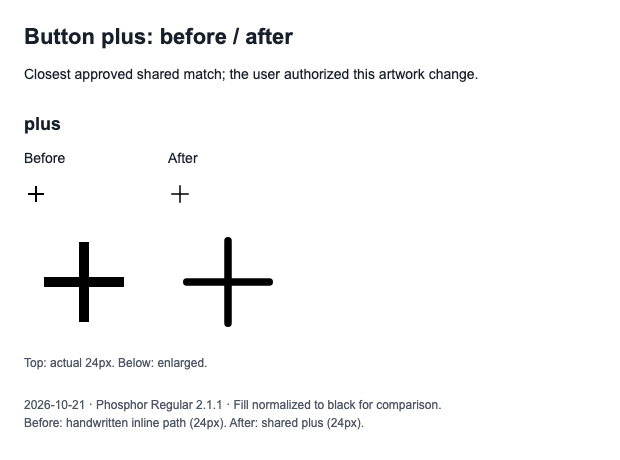
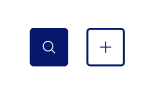

# Button icon adoption — 2026-10-21

Button now uses the approved `plus` from Phosphor Regular 2.1.1 through the shared
sprite. The canonical fixture references `/icons/sprite.svg#plus`; the docs and
Storybook bind that reference to the bundled asset URL, and the static example
binds it to its deployed `assets/icons/` directory.

The crop is a live visual reference, not a numeric geometry export.

## Comparison and decision

The original inline plus was handwritten, not a recorded Figma export. At its
24px rendered size it had square ends, 2px bars, and a 16px visible span.
Phosphor Regular has rounded ends, 1.5px bars, and an 18px visible span in the
same centered 24px square. This is an intentional appearance change, not a
pixel-identical substitution.

The live [Button Figma frame, node 808:2014](https://www.figma.com/design/jQ3EiYqe3uEvFbid5ewc41/Colorado-Design-System?node-id=808-2014&m=dev)
was inspected through the Aten Chrome profile on 2026-10-21. Its Icon Only
example uses a thin plus. The page still mentions Font Awesome in legacy icon
instructions; that text does not prove a Phosphor path match. Of the approved
shared artwork, Phosphor Regular `plus` is the closest match to that treatment.
The user explicitly approved replacing the thicker square-ended implementation
with this thinner rounded plus after reviewing the comparison. This records
that implementation decision; it does not assert design-owner or stable sign-off.

The native button retains its accessible name, a decorative and unfocusable SVG,
24px square icon geometry, default 48px minimum target, native disabled behavior,
state colors, and forced-colors system colors. The symmetric plus needs no RTL
mirroring. Source values remain in the pinned package and generated shared
sprite; no component-local path is maintained.
